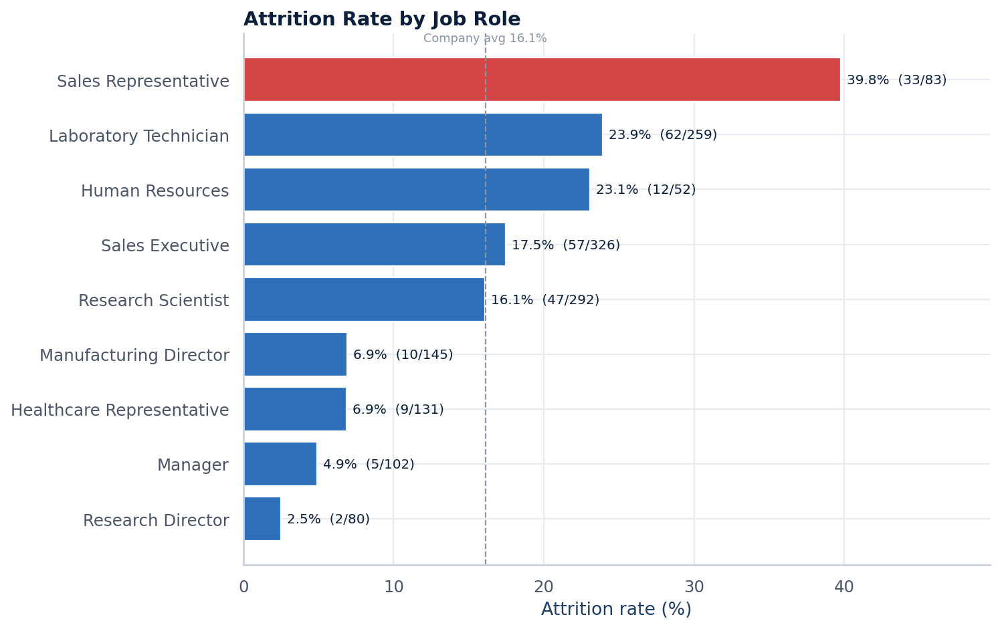
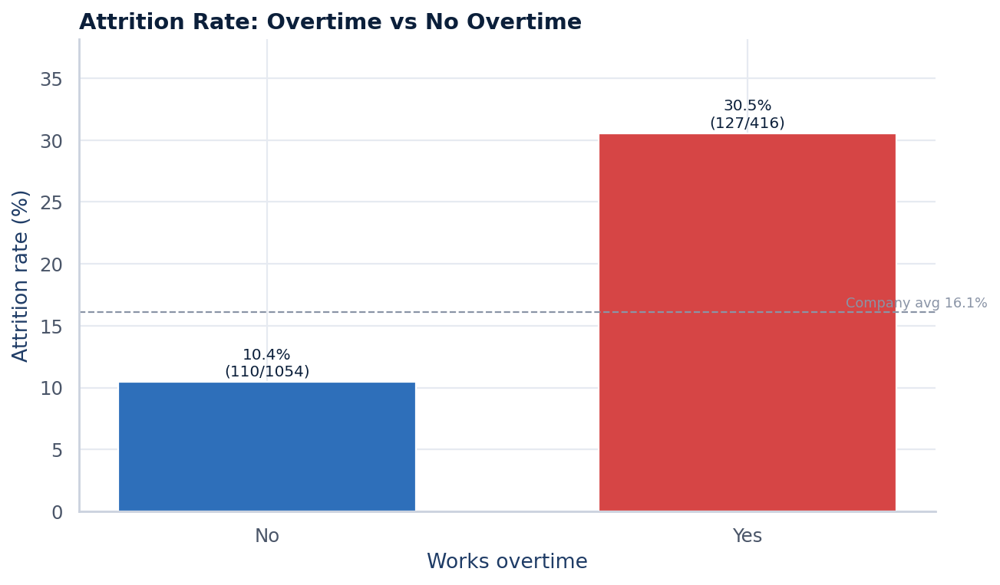
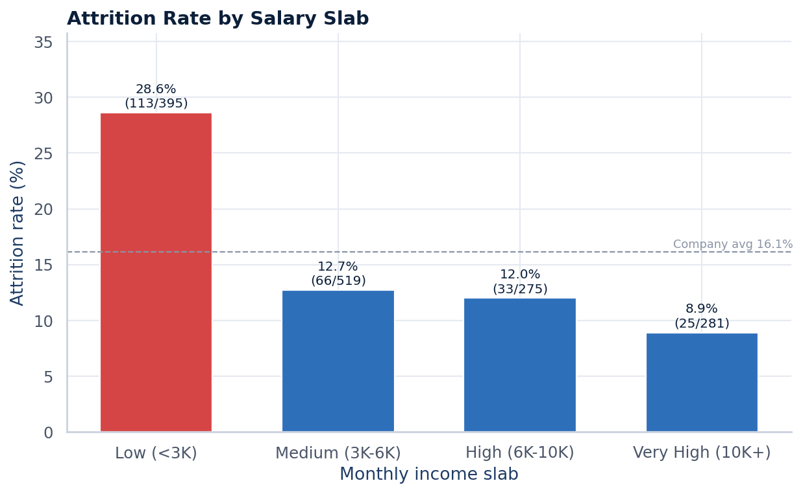
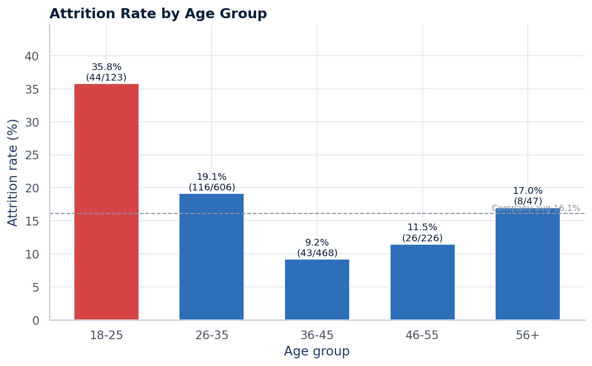

# HR Analytics & Employee Attrition Analysis


An end-to-end HR analytics project that explores **why employees leave**, using Python, SQL (MySQL), Excel, Power BI (DAX) and a Streamlit web app, and turns the findings into HR recommendations.

> **Data disclosure.** The dataset is the *IBM HR Analytics Employee Attrition & Performance* data, a **fictional dataset created by IBM data scientists**. No real company is described. Findings demonstrate method; they are not real-world facts. Every finding is an **association, not proof of cause**.

---

## Table of contents
1. [Business problem](#business-problem) · 2. [Objectives](#objectives) · 3. [Tech stack](#tech-stack) · 4. [Dataset](#dataset) · 5. [Architecture](#architecture) · 6. [Folder structure](#folder-structure) · 7. [Data cleaning](#data-cleaning-methodology) · 8. [SQL analysis](#sql-analysis) · 9. [Python EDA](#python-eda) · 10. [Excel](#excel-workbook) · 11. [Power BI](#power-bi) · 12. [Streamlit](#streamlit-dashboard) · 13. [Key insights](#key-business-insights) · 14. [Installation & run](#installation--how-to-run) · 15. [Verification status](#verification-status) · 16. [Future improvements](#future-improvements)

## Business problem
Replacing an employee is costly (recruiting, onboarding, lost knowledge). HR leaders need to know **where attrition concentrates** and **which factors travel with it**, so retention budgets go to the right places instead of being spread thin.

## Objectives
- Measure overall attrition and break it down by department, role, gender, age, pay, tenure, overtime, travel and satisfaction.
- Test which factors are statistically associated with leaving, and how strongly.
- Deliver the analysis in the formats analysts actually use: notebooks, SQL, Excel, BI dashboard and a web app.
- Give actionable recommendations while being explicit about correlation vs causation.

## Tech stack
| Layer | Tools |
|---|---|
| Analysis | Python 3.12, Pandas, NumPy, SciPy |
| Visualisation | Matplotlib, Seaborn (static) · Plotly (Streamlit) |
| Database | MySQL 8.0 (normalised schema, 30 queries) |
| Spreadsheet | Excel via openpyxl: formulas, conditional formatting, native charts |
| BI | Power BI Desktop + DAX (measures, theme, build guide) |
| App | Streamlit |
| Reporting | ReportLab (PDF), Jupyter notebooks |
| Workflow | Git / GitHub, VS Code, Windows 11 |

## Dataset
- **Source:** IBM HR Analytics Employee Attrition & Performance (commonly distributed on Kaggle as `WA_Fn-UseC_-HR-Employee-Attrition.csv`).
- **Size:** 1,470 employees x 35 columns; 237 leavers (16.1%).
- **Files:** `data/raw/` (original, untouched) and `data/processed/hr_attrition_cleaned.csv` (cleaned + engineered features).
- **Currency:** the data does not state one; `MonthlyIncome` is reported in source units.
- **Not in the data:** leaving dates, exit reasons, voluntary vs involuntary status. Causes therefore cannot be established.
- No synthetic data was added by this project.

## Architecture
```
 raw CSV --> data_cleaning.py --> cleaned CSV --+--> eda_analysis.py --> tables, statistics
                                                +--> visualization.py --> reports/figures/*.png
                                                +--> generate_sql_inserts.py --> MySQL (hr_analytics_db)
                                                +--> build_excel.py --> HR_Analytics_Report.xlsx
                                                +--> generate_report.py --> Business_Insights_Report.pdf
                                                +--> Power BI (import cleaned CSV + DAX)
                                                +--> dashboard/app.py (Streamlit)
```

## Folder structure
```
HR_Analytics_Attrition_Project/
├── data/
│   ├── raw/                    original IBM CSV
│   └── processed/              hr_attrition_cleaned.csv
├── notebooks/                  01 Exploration · 02 Cleaning · 03 EDA · 04 Business insights
├── python/                     config, data_cleaning, eda_analysis, visualization,
│                               generate_sql_inserts, validate_sql, build_excel,
│                               generate_report, build_notebooks, dashboard_utils, run_pipeline
├── sql/                        create_database · create_tables · insert_data · analysis_queries (30)
├── excel/                      HR_Analytics_Report.xlsx
├── powerbi/                    DAX_Measures.dax · HR_Analytics_Theme.json · POWERBI_BUILD_GUIDE.md
│                               (HR_Analytics_Dashboard.pbix: build it yourself, see guide)
├── reports/
│   ├── figures/                17 PNG charts
│   ├── tables/                 summary tables, statistical tests, SQL results (CSV)
│   ├── data_quality_report.json
│   └── Business_Insights_Report.pdf
├── dashboard/app.py            Streamlit app
├── docs/SETUP_GUIDE.md         Windows 11 + VS Code guide
├── README.md · requirements.txt · .gitignore
```

## Data cleaning methodology
Implemented in `python/data_cleaning.py`; results logged to `reports/data_quality_report.json`.
1. Load with `utf-8-sig` (the file has a BOM that corrupts the first column name otherwise).
2. Profile: **0 missing values, 0 duplicate rows, 0 duplicate employee numbers** (imputation and de-duplication logic is still implemented and runs).
3. Validate categorical domains and ordinal ranges (all pass) and logical consistency, e.g. tenure <= total experience (all pass).
4. Flag outliers with the IQR rule; **retained**, because high incomes and long tenures are genuine senior staff.
5. Cast dtypes; drop 3 constant columns (`EmployeeCount`, `Over18`, `StandardHours`).
6. Engineer `AttritionFlag`, `AgeGroup`, `SalarySlab`, `TenureBand`, `PromotionGap` (+ sort keys). Slab boundaries are analyst-defined (`python/config.py`).

## SQL analysis
Schema: `departments`, `job_roles`, `employees`, `employee_satisfaction`, `attrition_analysis` with primary/foreign keys, CHECK constraints and indexes. `job_roles` is not tied to a department because "Manager" appears in all three.
`sql/analysis_queries.sql` holds **30 queries**: KPIs, attrition by department / role / gender / age / salary / overtime / satisfaction / work-life balance, plus `JOIN`, `GROUP BY`, `HAVING`, `CASE WHEN`, subqueries, CTEs and window functions (`RANK`, `ROW_NUMBER`, `NTILE`, `LAG`, running `SUM`).
Run order: `create_database.sql` -> `create_tables.sql` -> `insert_data.sql` -> `analysis_queries.sql`.

## Python EDA
Notebooks `01`-`04` and the modules in `python/`. Besides rates by group, the analysis runs chi-square tests with Cramer's V, Mann-Whitney for income and point-biserial correlations. 17 charts are saved in `reports/figures/`.

| | |
|---|---|
|  |  |
|  |  |

## Excel workbook
`excel/HR_Analytics_Report.xlsx`: sheets `Raw_Data`, `Cleaned_Data`, `Attrition_Analysis`, `Department_Analysis`, `Salary_Analysis`, `Employee_Satisfaction`, `KPI_Summary`. Uses `COUNTIF`, `COUNTIFS`, `AVERAGEIF`, `IF`, `VLOOKUP`, `INDEX/MATCH`, colour-scale / data-bar / formula-based conditional formatting and native charts (571 live formulas). **Limitation:** PivotTables and PivotCharts cannot be generated by script, so formula-driven summary tables and standard charts are used instead; `docs/SETUP_GUIDE.md` shows how to add true PivotTables in two minutes. `XLOOKUP` was deliberately avoided for compatibility.

## Power BI
The `.pbix` file is **not included** (Power BI Desktop is Windows-only and could not be run to produce it). You get tested DAX measures (`Total Employees`, `Attrition Count`, `Active Employees`, `Attrition Rate`, `Average Salary`, `Average Age` plus extras), a navy/white theme and a visual-by-visual build guide for the 4 pages. See `powerbi/POWERBI_BUILD_GUIDE.md`. *Add your dashboard screenshots to `docs/screenshots/` and link them here once built.*

## Streamlit dashboard
`streamlit run dashboard/app.py`: upload a raw/cleaned CSV, filter by department / job role / overtime, KPI cards, interactive Plotly charts (overview, drivers, satisfaction, department), and downloads of the cleaned dataset and analysis results (Excel or ZIP).

## Key business insights
Computed from the data (see `reports/Business_Insights_Report.pdf` for full evidence):

| Question | Finding |
|---|---|
| Overall | **16.1%** attrition (237 of 1,470) |
| Highest-attrition department | **Sales 20.6%** (HR 19.0%, R&D 13.8%) |
| Highest-turnover role | **Sales Representative 39.8%** (33 of 83), also the lowest-paid role |
| Overtime | **30.5% vs 10.4%** without overtime (~2.9x), the strongest association tested |
| Salary | 28.6% in the lowest slab vs 8.9% in the highest; median income of leavers 3,202 vs 5,204 |
| Age | **18-25: 35.8%**, falling to ~9% at 36-45 |
| Job satisfaction | 22.8% at the lowest level vs 11.3% at the highest |
| Promotion gap | **No significant link** (p = 0.50) |
| Early tenure | 29.8% of employees with 0-2 years leave |

**Recommendations (summary):** target Sales Representative pay/onboarding/career path; audit overtime and workload; strengthen the first two years (mentoring, stay interviews); benchmark entry-level pay; widen stock-option access; use satisfaction surveys as early-warning flags; do not fund promotion-timing changes on this evidence alone; start collecting exit-interview data.

**Correlation is not causation.** Leavers differ from stayers on many fronts at once (they are younger, paid less, more junior and shorter-tenured), so no single factor is isolated as the cause.

## Installation & how to run
Full Windows 11 + VS Code instructions: [`docs/SETUP_GUIDE.md`](docs/SETUP_GUIDE.md).
```bash
python -m venv .venv && source .venv/bin/activate      # Windows: .\.venv\Scripts\Activate.ps1
pip install -r requirements.txt
python python/run_pipeline.py                          # clean -> EDA -> figures -> SQL -> Excel -> PDF -> notebooks
streamlit run dashboard/app.py                         # web dashboard
```

## Verification status
What was actually executed when this project was built:

| Component | Status |
|---|---|
| Cleaning, EDA, figures, PDF, Excel build, notebook build | Run end-to-end from a clean state without errors |
| Excel | Recalculated in LibreOffice: 571 formulas, 0 errors; key values cross-checked against pandas. Not opened in desktop Excel |
| SQL | All 30 queries executed in **SQLite** (JOIN/CTE/window functions) and 10 results cross-checked against pandas. Scripts use MySQL 8 syntax but were **not run on a MySQL server** |
| Notebooks | All code cells executed in-process; shipped **without saved outputs** (Jupyter not available in the build environment) |
| Streamlit app | Data helper functions tested; `app.py` compiles but was **not launched** (Streamlit/Plotly not installed in the build environment) |
| Power BI | **No `.pbix` created**; DAX/theme/guide only, not opened in Power BI Desktop |

## Future improvements
- Predictive model (logistic regression / gradient boosting) with proper validation, kept separate from the descriptive analysis.
- Survival analysis of time-to-exit once leaving dates are available.
- Automated tests and CI (GitHub Actions) for the pipeline and SQL.
- Scheduled data refresh and a published Power BI service report.
- Add exit-interview and manager data for causal investigation.

## License & credit
Dataset: IBM HR Analytics Employee Attrition & Performance (fictional, created by IBM data scientists). Code: add a LICENSE file of your choice (e.g. MIT) before publishing.
